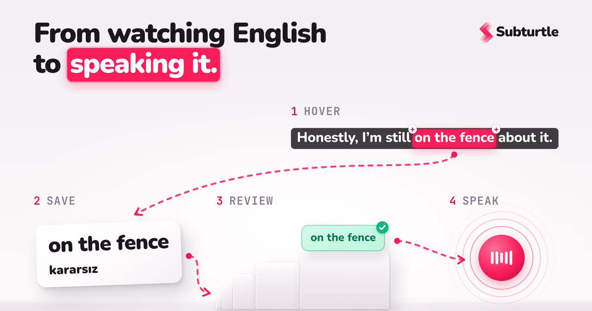

# SubTurtle Dashboard App

## Overview

SubTurtle helps people learn English from the shows they already watch. Learners hover a subtitle word on Netflix or YouTube (with the [SubTurtle extension](https://github.com/codebridger/subturtle-extension-apps)), save it, and then practise it here in the dashboard.



### What the dashboard does

- **Phrase bundles**: saved words and phrases grouped into bundles, with meaning, examples and pronunciation (Google Text-to-Speech)
- **Spaced repetition**: a Leitner-box review system that schedules each word for the right day
- **Flashcards and practice**: quick review sessions with statistics
- **Live AI coach**: real-time voice and text conversation practice on the Gemini Live API (primary) or OpenAI Realtime (legacy), using the learner's own saved words
- **Plans and billing**: freemium limits with token-based usage accounting and Stripe subscriptions
- **Multi-language UI**: interface translations with vue-i18n

## 🌐 Environments

| Environment | URL                                                                                                                                            |
| ----------- | ---------------------------------------------------------------------------------------------------------------------------------------------- |
| Landing     | [https://subturtle.app/](https://subturtle.app/)                                                                                               |
| Production  | [https://dashboard.subturtle.app/](https://dashboard.subturtle.app/)                                                                           |
| Development | [https://subturtle-dashboard-app-dev-344321252651.europe-west4.run.app](https://subturtle-dashboard-app-dev-344321252651.europe-west4.run.app) |

## 🏗️ Project Structure

```
subturtle-dashboard-app/
├── frontend/          # Nuxt.js frontend application
├── server/            # Node.js/TypeScript backend server
├── docker-compose.yml # Docker compose configuration
└── Dockerfile         # Docker configuration
```

## 🔗 Sibling Repositories

SubTurtle is split across several repositories. These siblings interact with the dashboard and may need to be cloned (or branched) locally to develop and test a cross-repo change end to end:

| Repo          | Purpose                                                                                              | Repository                                                                              |
| ------------- | --------------------------------------------------------------------------------------------------- | --------------------------------------------------------------------------------------- |
| **Extension** | Browser extension — the learn-by-subtitle capture surface. Shares the same `@modular-rest` backend. | [codebridger/subturtle-extension-apps](https://github.com/codebridger/subturtle-extension-apps) |
| **PilotUI**   | In-house Vue 3 + Tailwind component library (`pilotui`) consumed by the frontend.                    | [codebridger/pilotui](https://github.com/codebridger/pilotui)                           |

To work across repositories, clone the sibling next to this one (or reuse an existing local clone), create a feature branch on the sibling for any experimental change, run it locally, and point your dashboard branch at it. Keep dashboard-driven experiments on the sibling's feature branch — don't commit them to the sibling's `dev`/`main`.

## 🚀 Technology Stack

### Frontend

| Category             | Technology                   |
| -------------------- | ---------------------------- |
| Framework            | Nuxt.js (Vue.js)             |
| Language             | TypeScript                   |
| Styling              | Tailwind CSS                 |
| State Management     | Pinia (via stores directory) |
| Internationalization | i18n                         |
| Development Tools    | ESLint, Prettier             |

### Backend

| Category    | Technology                                                        |
| ----------- | ----------------------------------------------------------------- |
| Runtime     | Node.js                                                           |
| Language    | TypeScript                                                        |
| Framework   | [`@modular-rest/server`](https://github.com/modular-rest/modular-rest) (Koa + Mongoose) |
| Database    | MongoDB / Firestore with MongoDB compatibility                    |
| AI          | Gemini (`@google/genai`, Live API), OpenAI Realtime, Google Text-to-Speech |
| Payments    | Stripe subscriptions                                              |
| Testing     | Jest (server), Vitest and Playwright (frontend)                   |
| Environment | Docker containerized, Google Cloud Run                            |

## 🛠️ Setup & Installation

### Prerequisites

- Git
- Node.js and Yarn
- Docker and Docker Compose (for containerized setup)

### Installation Steps

1. **Clone the repository**

   ```bash
   git clone <repository-url>
   cd subturtle-dashboard-app
   ```

2. **Install dependencies**

   ```bash
   # Frontend dependencies
   cp frontend/.npmrc.sample frontend/.npmrc
   cd frontend
   yarn install

   # Backend dependencies
   cd ../server
   yarn install
   ```

3. **Set up environment variables**

   ```bash
   # Frontend
   cp frontend/.env.example frontend/.env

   # Backend
   cp server/sample.env server/.env
   ```

4. **Run the development environment**

   Using Docker:

   ```bash
   docker-compose up
   ```

   Or run services separately:

   ```bash
   # Frontend
   cd frontend
   yarn dev

   # Backend
   cd server
   yarn dev
   ```

## 🐳 Docker Configuration

The application is containerized using Docker for consistent development and deployment environments.

### Docker Commands

```bash
# Build and run all services
docker-compose up --build

# Run in detached mode
docker-compose up -d

# Stop all services
docker-compose down
```

## 🔧 Configuration Options

| Component | Configuration Location                          |
| --------- | ----------------------------------------------- |
| Frontend  | `frontend/nuxt.config.ts`                       |
| Backend   | Environment variables (see `server/sample.env`) |
| Docker    | `docker-compose.yml` and `Dockerfile`           |

## 📝 Development Guidelines

1. **Code Quality**

   - Follow the established code style (ESLint & Prettier configurations)
   - Write clean, maintainable, and documented code

2. **TypeScript Usage**

   - Use TypeScript types appropriately
   - Leverage type safety features

3. **Version Control**

   - Follow the Git workflow
   - Adhere to commit message conventions

4. **Testing**
   - Write tests for new features
   - Ensure existing tests pass before submitting changes

## 🚀 Deployment Process

The application is deployed using Google Cloud Run with the following workflow:

- **Production**: Automated deployments through GitHub Actions
- **Development**: Deployments triggered on merges to the development branch

## 📚 Additional Resources

- [Nuxt.js Documentation](https://nuxtjs.org/docs/get-started/installation)
- [Tailwind CSS Documentation](https://tailwindcss.com/docs)
- [Pinia Documentation](https://pinia.vuejs.org/)
- [Docker Documentation](https://docs.docker.com/)
